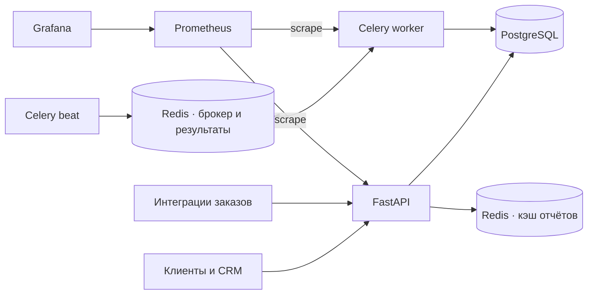
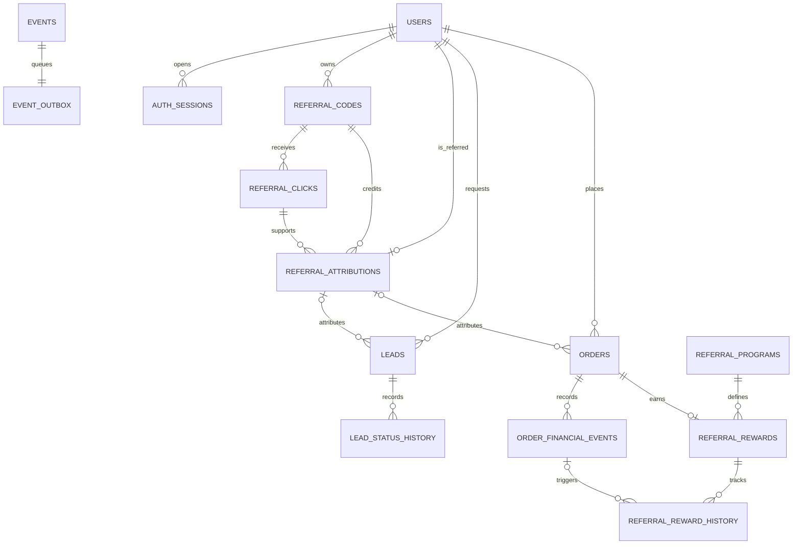
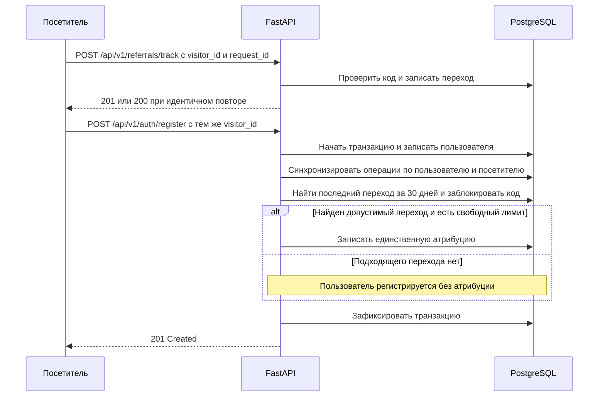

# Архитектура Referral Analytics Service

FastAPI принимает запросы пользователей и интеграций. PostgreSQL хранит состояния сущностей, финансовые операции и очередь событий. Celery beat планирует фоновые задачи, а воркеры выполняют их через Redis. Redis также хранит результаты задач и кэш отчётов. API читает бизнес-данные из PostgreSQL с учётом области доступа пользователя.

Запись события и outbox происходит в одной транзакции. Воркеры блокируют доступные записи через `SKIP LOCKED`, а обработчик финансовых событий сериализует изменения по заказу. Запись финансовой операции, перерасчёт вознаграждения и отметка об обработке фиксируются вместе. При ошибке временная задержка освобождает очередь для остальных событий. [Диаграмма обработки событий и расписание задач](workers.md)

## Основные связи данных

Диаграмма показывает бизнес-сущности и связи внешних ключей. Несколько ролей пользователя, например владелец кода и приглашённый, хранятся как ссылки на одну таблицу `users`. Технические таблицы кэша, снимков и ключей интеграций описаны ниже.

- `integration_credentials` хранит хеши ключей. `events` и `orders` связываются с источником по `source_system`, который определяется сервером по ключу интеграции.
- `analytics_cache_revisions` хранит ревизии данных. Запись в таблицы отчётов обновляет ревизии в той же транзакции. При чтении отчёта ревизия и права пользователя участвуют в ключе Redis.
- `analytics_snapshot_requests` хранит изменившиеся даты. `analytics_daily_snapshots` хранит готовые агрегаты, а `analytics_snapshot_failures` — даты, по которым пересчёт исчерпал попытки.

## Атрибуция регистрации

Код проверяется на активность, срок действия, самоприглашение и число сохранённых атрибуций. Если кандидат недопустим, обработчик ищет более ранний переход. UUID посетителя остаётся в домене отслеживания и служит только для связи переходов с регистрацией. [Правила атрибуции и реферальные коды](referrals.md)

Атрибуция заказа фиксируется при его создании. При первой оплате сервис выбирает действующую программу по времени операции и валюте. Последующие возвраты и корректировки пересчитывают сумму по сохранённым правилам. [Заказы](orders.md), [Вознаграждения](rewards.md), [Аналитика](analytics.md).
