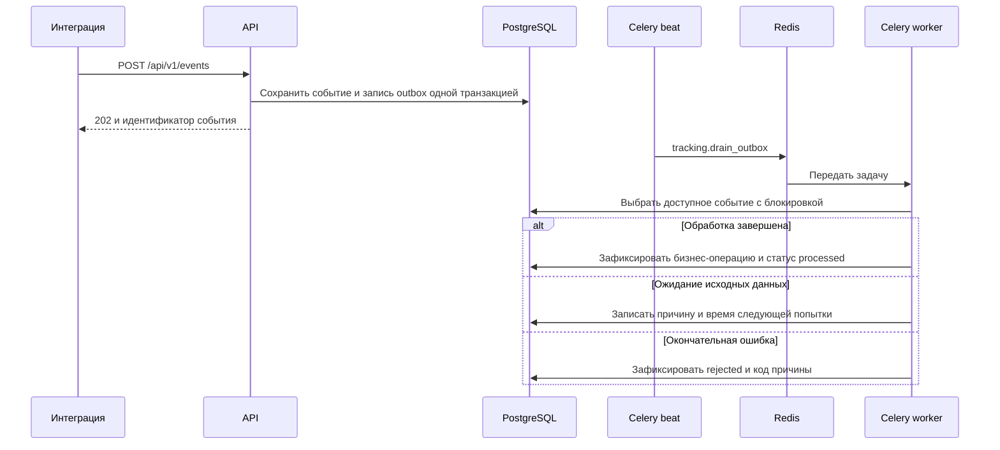

# Фоновые задачи и дневные срезы

Celery beat публикует задачи в Redis. Для одного расписания запускают один экземпляр beat. Можно запустить несколько воркеров. PostgreSQL хранит входящие события, результаты обработки и запросы на пересчёт. Перед запуском обновлённых процессов примените миграции.

```bash
docker compose build
docker compose run --rm api alembic upgrade head
docker compose up -d
```

## Расписание

| Задача | Когда запускается | Что делает за запуск |
| --- | --- | --- |
| `tracking.drain_outbox` | Каждые 5 секунд | Берёт до 50 доступных событий. Сохраняет оплату и связанное вознаграждение одной транзакцией. |
| `analytics.recalculate_pending` | Каждую минуту | Ставит в очередь пересчёт максимум 31 даты, начиная с самого старого запроса. |
| `analytics.daily_snapshot` | В 00:05 UTC | Записывает запрос на срез за предыдущие сутки и передаёт его воркеру, в том числе для дня без операций. |
| `analytics.refresh_day` | По запросу | Собирает общий отчёт за заданные сутки UTC и сохраняет его в PostgreSQL. |
| `maintenance.cleanup_sessions` | Каждые 5 минут | Удаляет до 1000 сессий с истёкшим сроком действия refresh-токена. |

## Путь события



## Как обновляется срез

Триггеры PostgreSQL записывают затронутые даты при изменении переходов, атрибуций, лидов, финансовых операций и истории вознаграждений. Запрос на пересчёт фиксируется в той же транзакции. Миграция также ставит в очередь даты из существующих записей.

Срез содержит переходы, атрибутированные регистрации, воронку лидов, выручку и вознаграждения. Денежные показатели разделены по валютам. Интервал начинается в 00:00 UTC и заканчивается в 00:00 следующих суток, правая граница исключена. Расчёт использует те же правила, что и общий отчёт `overview`.

Воркер читает данные с уровнем изоляции `REPEATABLE READ` и берёт транзакционную блокировку на дату. Он записывает результат и удаляет обработанные запросы одной транзакцией. Изменения, зафиксированные во время расчёта, остаются в очереди. При повторном расчёте с теми же данными сохраняется прежнее значение `refreshed_at`.

```sql
SELECT day, refreshed_at, report
FROM analytics_daily_snapshots
WHERE day = DATE '2026-11-01';
```

## Наблюдение и восстановление

В логах воркера каждый запуск имеет `task_id`. После временной ошибки Celery выполняет до пяти повторов с экспоненциальной задержкой. Состояния задач доступны в Redis через `CELERY_RESULT_BACKEND` в течение 48 часов. По умолчанию Compose использует базы Redis 0 для кэша, 1 для брокера и 2 для результатов.

```bash
docker compose exec celery-worker celery -A app.workers.celery_app:celery_app inspect active
docker compose exec celery-worker celery -A app.workers.celery_app:celery_app events --dump
docker compose exec celery-worker celery -A app.workers.celery_app:celery_app result TASK_ID
```

У задачи обработки очереди и у каждого события разные результаты. Воркер может успешно завершить пакет, в котором отдельное событие отклонено. Для проверки окончательных ошибок событий и дат используйте два запроса.

```sql
SELECT event_id, attempts, last_error FROM event_outbox WHERE state = 'failed';
SELECT day, task_id, failed_at FROM analytics_snapshot_failures ORDER BY failed_at DESC;
```

После исчерпания повторов пересчёта диспетчер пропускает проблемную дату, чтобы обрабатывать остальные. После устранения причины запустите пересчёт вручную. Эта же команда восстанавливает срез за пустой день, если beat был остановлен в момент ежедневного запуска. Успешный пересчёт снимает отметку об ошибке.

```bash
docker compose exec celery-worker celery -A app.workers.celery_app:celery_app call analytics.refresh_day --args '["2026-11-01"]'
```

Порядок повторной обработки отдельного события описан в [документации интеграционного API](tracking.md).
